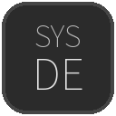
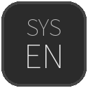

  
  

<h1> Monowlith</h1>

## Projects and learning resources

Open educational resources and independent projects on GitHub.

## Learning Courses

Structured learning materials across 22 school and university courses in mathematics, computer science, natural sciences, engineering, architecture and business, each available in English and German. The dedicated web reader offers search, notes, bookmarks and saved reading progress. All courses are freely accessible.

**[Open course selection](https://monowlith-com.github.io/learning-courses/index.html?syslang=en&doclang=en&theme=light)** · [Learning Courses repository](https://github.com/Monowlith-com/learning-courses)

### University

- **[University · Aerospace Engineering](https://monowlith-com.github.io/learning-courses/index.html?course=university_aerospace-engineering&syslang=en&doclang=en&theme=light)** (English, German) · 10 modules · 33 lessons · 36 documents · [EN Repo](https://github.com/Monowlith-com/learning-courses-university-aerospace-engineering-en) · [DE Repo](https://github.com/Monowlith-com/learning-courses-university-aerospace-engineering-de)
- **[University · Architecture and Building Information Modeling](https://monowlith-com.github.io/learning-courses/index.html?course=university_architecture-and-building-information-modeling&syslang=en&doclang=en&theme=light)** (English, German) · 12 modules · 36 lessons · 39 documents · [EN Repo](https://github.com/Monowlith-com/learning-courses-university-architecture-and-building-information-modeling-en) · [DE Repo](https://github.com/Monowlith-com/learning-courses-university-architecture-and-building-information-modeling-de)
- **[University · Biology](https://monowlith-com.github.io/learning-courses/index.html?course=university_biology&syslang=en&doclang=en&theme=light)** (English, German) · 27 modules · 144 lessons · 147 documents · [EN Repo](https://github.com/Monowlith-com/learning-courses-university-biology-en) · [DE Repo](https://github.com/Monowlith-com/learning-courses-university-biology-de)
- **[University · Business Administration](https://monowlith-com.github.io/learning-courses/index.html?course=university_business-administration&syslang=en&doclang=en&theme=light)** (English, German) · 21 modules · 63 lessons · 67 documents · [EN Repo](https://github.com/Monowlith-com/learning-courses-university-business-administration-en) · [DE Repo](https://github.com/Monowlith-com/learning-courses-university-business-administration-de)
- **[University · Business Information Systems](https://monowlith-com.github.io/learning-courses/index.html?course=university_business-information-systems&syslang=en&doclang=en&theme=light)** (English, German) · 22 modules · 73 lessons · 76 documents · [EN Repo](https://github.com/Monowlith-com/learning-courses-university-business-information-systems-en) · [DE Repo](https://github.com/Monowlith-com/learning-courses-university-business-information-systems-de)
- **[University · Chemistry](https://monowlith-com.github.io/learning-courses/index.html?course=university_chemistry&syslang=en&doclang=en&theme=light)** (English, German) · 30 modules · 150 lessons · 153 documents · [EN Repo](https://github.com/Monowlith-com/learning-courses-university-chemistry-en) · [DE Repo](https://github.com/Monowlith-com/learning-courses-university-chemistry-de)
- **[University · Civil Engineering](https://monowlith-com.github.io/learning-courses/index.html?course=university_civil-engineering&syslang=en&doclang=en&theme=light)** (English, German) · 22 modules · 88 lessons · 91 documents · [EN Repo](https://github.com/Monowlith-com/learning-courses-university-civil-engineering-en) · [DE Repo](https://github.com/Monowlith-com/learning-courses-university-civil-engineering-de)
- **[University · Computer Science](https://monowlith-com.github.io/learning-courses/index.html?course=university_computer-science&syslang=en&doclang=en&theme=light)** / Universität · Informatik (English, German) · 20 modules · 78 lessons · 90 documents · [EN Repo](https://github.com/Monowlith-com/learning-courses-university-computer-science-en) · [DE Repo](https://github.com/Monowlith-com/learning-courses-university-computer-science-de)
- **[University · Data Science and Artificial Intelligence](https://monowlith-com.github.io/learning-courses/index.html?course=university_data-science-and-artificial-intelligence&syslang=en&doclang=en&theme=light)** (English, German) · 31 modules · 240 lessons · 243 documents · [EN Repo](https://github.com/Monowlith-com/learning-courses-university-data-science-and-artificial-intelligence-en) · [DE Repo](https://github.com/Monowlith-com/learning-courses-university-data-science-and-artificial-intelligence-de)
- **[University · Electrical Engineering](https://monowlith-com.github.io/learning-courses/index.html?course=university_electrical-engineering-core&syslang=en&doclang=en&theme=light)** (English, German) · 37 modules · 184 lessons · 187 documents · [EN Repo](https://github.com/Monowlith-com/learning-courses-university-electrical-engineering-en) · [DE Repo](https://github.com/Monowlith-com/learning-courses-university-electrical-engineering-de)
- **[University · Electrical Engineering and Information Technology](https://monowlith-com.github.io/learning-courses/index.html?course=university_electrical-engineering&syslang=en&doclang=en&theme=light)** (English, German) · 31 modules · 171 lessons · 173 documents · [EN Repo](https://github.com/Monowlith-com/learning-courses-university-electrical-engineering-and-information-technology-en) · [DE Repo](https://github.com/Monowlith-com/learning-courses-university-electrical-engineering-and-information-technology-de)
- **[University · Embedded Systems and Sensor Technology](https://monowlith-com.github.io/learning-courses/index.html?course=university_embedded-systems&syslang=en&doclang=en&theme=light)** (English, German) · 26 modules · 130 lessons · 133 documents · [EN Repo](https://github.com/Monowlith-com/learning-courses-university-embedded-systems-and-sensor-technology-en) · [DE Repo](https://github.com/Monowlith-com/learning-courses-university-embedded-systems-and-sensor-technology-de)
- **[University · Energy Systems and Grid Engineering](https://monowlith-com.github.io/learning-courses/index.html?course=university_energy-systems-and-grid-engineering&syslang=en&doclang=en&theme=light)** (English, German) · 7 modules · 21 lessons · 24 documents · [EN Repo](https://github.com/Monowlith-com/learning-courses-university-energy-systems-and-grid-engineering-en) · [DE Repo](https://github.com/Monowlith-com/learning-courses-university-energy-systems-and-grid-engineering-de)
- **[University · General Engineering](https://monowlith-com.github.io/learning-courses/index.html?course=university_general-engineering&syslang=en&doclang=en&theme=light)** (English, German) · 7 modules · 21 lessons · 24 documents · [EN Repo](https://github.com/Monowlith-com/learning-courses-university-general-engineering-en) · [DE Repo](https://github.com/Monowlith-com/learning-courses-university-general-engineering-de)
- **[University · Mathematics](https://monowlith-com.github.io/learning-courses/index.html?course=university_mathematics&syslang=en&doclang=en&theme=light)** / Universität · Mathematik (English, German) · 11 modules · 72 lessons · 82 documents · [EN Repo](https://github.com/Monowlith-com/learning-courses-university-mathematics-en) · [DE Repo](https://github.com/Monowlith-com/learning-courses-university-mathematics-de)
- **[University · Mechanical Engineering](https://monowlith-com.github.io/learning-courses/index.html?course=university_mechanical-engineering&syslang=en&doclang=en&theme=light)** (English, German) · 16 modules · 85 lessons · 88 documents · [EN Repo](https://github.com/Monowlith-com/learning-courses-university-mechanical-engineering-en) · [DE Repo](https://github.com/Monowlith-com/learning-courses-university-mechanical-engineering-de)
- **[University · Physics](https://monowlith-com.github.io/learning-courses/index.html?course=university_physics&syslang=en&doclang=en&theme=light)** (English, German) · 43 modules · 323 lessons · 326 documents · [EN Repo](https://github.com/Monowlith-com/learning-courses-university-physics-en) · [DE Repo](https://github.com/Monowlith-com/learning-courses-university-physics-de)
- **[University · Robotics and Autonomous Systems](https://monowlith-com.github.io/learning-courses/index.html?course=university_robotics-and-autonomous-systems&syslang=en&doclang=en&theme=light)** (English, German) · 32 modules · 131 lessons · 134 documents · [EN Repo](https://github.com/Monowlith-com/learning-courses-university-robotics-and-autonomous-systems-en) · [DE Repo](https://github.com/Monowlith-com/learning-courses-university-robotics-and-autonomous-systems-de)
- **[University · Satellite Technology and Space Systems Engineering](https://monowlith-com.github.io/learning-courses/index.html?course=university_satellite-technology-and-space-systems-engineering&syslang=en&doclang=en&theme=light)** (English, German) · 16 modules · 48 lessons · 51 documents · [EN Repo](https://github.com/Monowlith-com/learning-courses-university-satellite-technology-and-space-systems-engineering-en) · [DE Repo](https://github.com/Monowlith-com/learning-courses-university-satellite-technology-and-space-systems-engineering-de)

### School

- **[School · Computer Science](https://monowlith-com.github.io/learning-courses/index.html?course=school_computer-science&syslang=en&doclang=en&theme=light)** / Schule · Informatik (English, German) · 12 modules · 50 lessons · 53 documents · [EN Repo](https://github.com/Monowlith-com/learning-courses-school-computer-science-en) · [DE Repo](https://github.com/Monowlith-com/learning-courses-school-computer-science-de)
- **[School · Mathematics](https://monowlith-com.github.io/learning-courses/index.html?course=school_mathematics&syslang=en&doclang=en&theme=light)** / Schule · Mathematik (English, German) · 8 modules · 52 lessons · 55 documents · [EN Repo](https://github.com/Monowlith-com/learning-courses-school-mathematics-en) · [DE Repo](https://github.com/Monowlith-com/learning-courses-school-mathematics-de)
- **[School · Physics](https://monowlith-com.github.io/learning-courses/index.html?course=school_physics&syslang=en&doclang=en&theme=light)** (English, German) · 24 modules · 149 lessons · 152 documents · [EN Repo](https://github.com/Monowlith-com/learning-courses-school-physics-en) · [DE Repo](https://github.com/Monowlith-com/learning-courses-school-physics-de)

## About Monowlith

Monowlith brings together independent projects, structured knowledge and educational resources. Learning Courses is an initiative for independent, self-paced learning without a paywall. Course source documents are available in the corresponding repositories.

[Monowlith GitHub website](https://monowlith-com.github.io/?syslang=en&doclang=en&theme=light) · [monowlith.com](https://monowlith.com) · [All repositories](https://github.com/orgs/Monowlith-com/repositories)

## License

Learning Courses materials are published under [CC BY-NC-SA 4.0](https://creativecommons.org/licenses/by-nc-sa/4.0/). See the individual repositories for the applicable scope and attribution.
