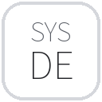
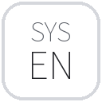
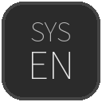

  
  
  
  

<h1> Monowlith</h1>

## Projekte und Lernangebote

Offene Bildungsangebote und unabhängige Projekte auf GitHub.

## Lernkurse · Learning Courses

Strukturierte Lernangebote mit Modulen und Lektionen zu Mathematik und Informatik. Der eigene Webreader bietet Suche, Notizen, Lesezeichen und einen gespeicherten Lesestand. Alle Kurse sind frei zugänglich.

**[Kursübersicht öffnen](https://monowlith-com.github.io/learning-courses/index.html?syslang=de&doclang=de&theme=light)** · [Learning-Courses-Repository](https://github.com/Monowlith-com/learning-courses)

### Universität

- **[Universität · Informatik](https://monowlith-com.github.io/learning-courses/index.html?course=university_computer-science&syslang=de&doclang=de&theme=light)** (Deutsch) · [Repository](https://github.com/Monowlith-com/learning-courses-university-computer-science-de)
- **[Universität · Mathematik](https://monowlith-com.github.io/learning-courses/index.html?course=university_mathematics&syslang=de&doclang=de&theme=light)** (Deutsch) · [Repository](https://github.com/Monowlith-com/learning-courses-university-mathematics-de)

### Schule

- **[Schule · Mathematik](https://monowlith-com.github.io/learning-courses/index.html?course=school_mathematics&syslang=de&doclang=de&theme=light)** (Deutsch) · [Repository](https://github.com/Monowlith-com/learning-courses-school-mathematics-de)

## Über Monowlith

Monowlith bündelt unabhängige Projekte, strukturiertes Wissen und Bildungsangebote. Learning Courses ist eine Initiative für selbstständiges Lernen im eigenen Tempo ohne Bezahlschranke. Die Kursquellen stehen in den jeweiligen Repositories zur Verfügung.

[Monowlith GitHub Webseite](https://monowlith-com.github.io/?syslang=de&doclang=de&theme=light) · [monowlith.com](https://monowlith.com) · [Alle Repositories](https://github.com/orgs/Monowlith-com/repositories)

## Lizenz

Die Lernmaterialien von Learning Courses stehen unter [CC BY-NC-SA 4.0](https://creativecommons.org/licenses/by-nc-sa/4.0/). Geltungsbereich und Namensnennung sind in den jeweiligen Repositories angegeben.
