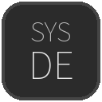

  
  

<h1> Monowlith</h1>

## Projekte und Lernangebote

Offene Bildungsangebote und unabhängige Projekte auf GitHub.

## Lernkurse · Learning Courses

Strukturierte Lernangebote in 22 Schul- und Universitätskursen zu Mathematik, Informatik, Naturwissenschaften, Ingenieurwissenschaften, Architektur und Wirtschaft, jeweils auf Deutsch und Englisch. Der eigene Webreader bietet Suche, Notizen, Lesezeichen und einen gespeicherten Lesestand. Alle Kurse sind frei zugänglich.

**[Kursübersicht öffnen](https://monowlith-com.github.io/learning-courses/index.html?syslang=de&doclang=de&theme=light)** · [Learning-Courses-Repository](https://github.com/Monowlith-com/learning-courses)

### Universität

- **[Universität · Luft- und Raumfahrttechnik](https://monowlith-com.github.io/learning-courses/index.html?course=university_aerospace-engineering&syslang=de&doclang=de&theme=light)** (Deutsch, Englisch) · 10 Module · 33 Lektionen · 36 Dokumente · [DE Repo](https://github.com/Monowlith-com/learning-courses-university-aerospace-engineering-de) · [EN Repo](https://github.com/Monowlith-com/learning-courses-university-aerospace-engineering-en)
- **[Universität · Architektur und Building Information Modeling](https://monowlith-com.github.io/learning-courses/index.html?course=university_architecture-and-building-information-modeling&syslang=de&doclang=de&theme=light)** (Deutsch, Englisch) · 12 Module · 36 Lektionen · 39 Dokumente · [DE Repo](https://github.com/Monowlith-com/learning-courses-university-architecture-and-building-information-modeling-de) · [EN Repo](https://github.com/Monowlith-com/learning-courses-university-architecture-and-building-information-modeling-en)
- **[Universität · Biologie](https://monowlith-com.github.io/learning-courses/index.html?course=university_biology&syslang=de&doclang=de&theme=light)** (Deutsch, Englisch) · 27 Module · 144 Lektionen · 147 Dokumente · [DE Repo](https://github.com/Monowlith-com/learning-courses-university-biology-de) · [EN Repo](https://github.com/Monowlith-com/learning-courses-university-biology-en)
- **[Universität · Betriebswirtschaftslehre](https://monowlith-com.github.io/learning-courses/index.html?course=university_business-administration&syslang=de&doclang=de&theme=light)** (Deutsch, Englisch) · 21 Module · 63 Lektionen · 67 Dokumente · [DE Repo](https://github.com/Monowlith-com/learning-courses-university-business-administration-de) · [EN Repo](https://github.com/Monowlith-com/learning-courses-university-business-administration-en)
- **[Universität · Wirtschaftsinformatik](https://monowlith-com.github.io/learning-courses/index.html?course=university_business-information-systems&syslang=de&doclang=de&theme=light)** (Deutsch, Englisch) · 22 Module · 73 Lektionen · 76 Dokumente · [DE Repo](https://github.com/Monowlith-com/learning-courses-university-business-information-systems-de) · [EN Repo](https://github.com/Monowlith-com/learning-courses-university-business-information-systems-en)
- **[Universität · Chemie](https://monowlith-com.github.io/learning-courses/index.html?course=university_chemistry&syslang=de&doclang=de&theme=light)** (Deutsch, Englisch) · 30 Module · 150 Lektionen · 153 Dokumente · [DE Repo](https://github.com/Monowlith-com/learning-courses-university-chemistry-de) · [EN Repo](https://github.com/Monowlith-com/learning-courses-university-chemistry-en)
- **[Universität · Bauingenieurwesen](https://monowlith-com.github.io/learning-courses/index.html?course=university_civil-engineering&syslang=de&doclang=de&theme=light)** (Deutsch, Englisch) · 22 Module · 88 Lektionen · 91 Dokumente · [DE Repo](https://github.com/Monowlith-com/learning-courses-university-civil-engineering-de) · [EN Repo](https://github.com/Monowlith-com/learning-courses-university-civil-engineering-en)
- **[Universität · Informatik](https://monowlith-com.github.io/learning-courses/index.html?course=university_computer-science&syslang=de&doclang=de&theme=light)** / University · Computer Science (Deutsch, Englisch) · 20 Module · 78 Lektionen · 90 Dokumente · [DE Repo](https://github.com/Monowlith-com/learning-courses-university-computer-science-de) · [EN Repo](https://github.com/Monowlith-com/learning-courses-university-computer-science-en)
- **[Universität · Data Science und Künstliche Intelligenz](https://monowlith-com.github.io/learning-courses/index.html?course=university_data-science-and-artificial-intelligence&syslang=de&doclang=de&theme=light)** (Deutsch, Englisch) · 31 Module · 240 Lektionen · 243 Dokumente · [DE Repo](https://github.com/Monowlith-com/learning-courses-university-data-science-and-artificial-intelligence-de) · [EN Repo](https://github.com/Monowlith-com/learning-courses-university-data-science-and-artificial-intelligence-en)
- **[Universität · Elektrotechnik](https://monowlith-com.github.io/learning-courses/index.html?course=university_electrical-engineering-core&syslang=de&doclang=de&theme=light)** (Deutsch, Englisch) · 37 Module · 184 Lektionen · 187 Dokumente · [DE Repo](https://github.com/Monowlith-com/learning-courses-university-electrical-engineering-de) · [EN Repo](https://github.com/Monowlith-com/learning-courses-university-electrical-engineering-en)
- **[Universität · Elektrotechnik und Informationstechnik](https://monowlith-com.github.io/learning-courses/index.html?course=university_electrical-engineering&syslang=de&doclang=de&theme=light)** (Deutsch, Englisch) · 31 Module · 171 Lektionen · 173 Dokumente · [DE Repo](https://github.com/Monowlith-com/learning-courses-university-electrical-engineering-and-information-technology-de) · [EN Repo](https://github.com/Monowlith-com/learning-courses-university-electrical-engineering-and-information-technology-en)
- **[Universität · Embedded Systems und Sensorik](https://monowlith-com.github.io/learning-courses/index.html?course=university_embedded-systems&syslang=de&doclang=de&theme=light)** (Deutsch, Englisch) · 26 Module · 130 Lektionen · 133 Dokumente · [DE Repo](https://github.com/Monowlith-com/learning-courses-university-embedded-systems-and-sensor-technology-de) · [EN Repo](https://github.com/Monowlith-com/learning-courses-university-embedded-systems-and-sensor-technology-en)
- **[Universität · Energiesysteme und Netztechnik](https://monowlith-com.github.io/learning-courses/index.html?course=university_energy-systems-and-grid-engineering&syslang=de&doclang=de&theme=light)** (Deutsch, Englisch) · 7 Module · 21 Lektionen · 24 Dokumente · [DE Repo](https://github.com/Monowlith-com/learning-courses-university-energy-systems-and-grid-engineering-de) · [EN Repo](https://github.com/Monowlith-com/learning-courses-university-energy-systems-and-grid-engineering-en)
- **[Universität · Allgemeine Ingenieurwissenschaften](https://monowlith-com.github.io/learning-courses/index.html?course=university_general-engineering&syslang=de&doclang=de&theme=light)** (Deutsch, Englisch) · 7 Module · 21 Lektionen · 24 Dokumente · [DE Repo](https://github.com/Monowlith-com/learning-courses-university-general-engineering-de) · [EN Repo](https://github.com/Monowlith-com/learning-courses-university-general-engineering-en)
- **[Universität · Mathematik](https://monowlith-com.github.io/learning-courses/index.html?course=university_mathematics&syslang=de&doclang=de&theme=light)** / University · Mathematics (Deutsch, Englisch) · 11 Module · 72 Lektionen · 82 Dokumente · [DE Repo](https://github.com/Monowlith-com/learning-courses-university-mathematics-de) · [EN Repo](https://github.com/Monowlith-com/learning-courses-university-mathematics-en)
- **[Universität · Maschinenbau](https://monowlith-com.github.io/learning-courses/index.html?course=university_mechanical-engineering&syslang=de&doclang=de&theme=light)** (Deutsch, Englisch) · 16 Module · 85 Lektionen · 88 Dokumente · [DE Repo](https://github.com/Monowlith-com/learning-courses-university-mechanical-engineering-de) · [EN Repo](https://github.com/Monowlith-com/learning-courses-university-mechanical-engineering-en)
- **[Universität · Physik](https://monowlith-com.github.io/learning-courses/index.html?course=university_physics&syslang=de&doclang=de&theme=light)** (Deutsch, Englisch) · 43 Module · 323 Lektionen · 326 Dokumente · [DE Repo](https://github.com/Monowlith-com/learning-courses-university-physics-de) · [EN Repo](https://github.com/Monowlith-com/learning-courses-university-physics-en)
- **[Universität · Robotik und autonome Systeme](https://monowlith-com.github.io/learning-courses/index.html?course=university_robotics-and-autonomous-systems&syslang=de&doclang=de&theme=light)** (Deutsch, Englisch) · 32 Module · 131 Lektionen · 134 Dokumente · [DE Repo](https://github.com/Monowlith-com/learning-courses-university-robotics-and-autonomous-systems-de) · [EN Repo](https://github.com/Monowlith-com/learning-courses-university-robotics-and-autonomous-systems-en)
- **[Universität · Satellitentechnik und Raumfahrtsystemtechnik](https://monowlith-com.github.io/learning-courses/index.html?course=university_satellite-technology-and-space-systems-engineering&syslang=de&doclang=de&theme=light)** (Deutsch, Englisch) · 16 Module · 48 Lektionen · 51 Dokumente · [DE Repo](https://github.com/Monowlith-com/learning-courses-university-satellite-technology-and-space-systems-engineering-de) · [EN Repo](https://github.com/Monowlith-com/learning-courses-university-satellite-technology-and-space-systems-engineering-en)

### Schule

- **[Schule · Informatik](https://monowlith-com.github.io/learning-courses/index.html?course=school_computer-science&syslang=de&doclang=de&theme=light)** / School · Computer Science (Deutsch, Englisch) · 12 Module · 50 Lektionen · 53 Dokumente · [DE Repo](https://github.com/Monowlith-com/learning-courses-school-computer-science-de) · [EN Repo](https://github.com/Monowlith-com/learning-courses-school-computer-science-en)
- **[Schule · Mathematik](https://monowlith-com.github.io/learning-courses/index.html?course=school_mathematics&syslang=de&doclang=de&theme=light)** / School · Mathematics (Deutsch, Englisch) · 8 Module · 52 Lektionen · 55 Dokumente · [DE Repo](https://github.com/Monowlith-com/learning-courses-school-mathematics-de) · [EN Repo](https://github.com/Monowlith-com/learning-courses-school-mathematics-en)
- **[Schule · Physik](https://monowlith-com.github.io/learning-courses/index.html?course=school_physics&syslang=de&doclang=de&theme=light)** (Deutsch, Englisch) · 24 Module · 149 Lektionen · 152 Dokumente · [DE Repo](https://github.com/Monowlith-com/learning-courses-school-physics-de) · [EN Repo](https://github.com/Monowlith-com/learning-courses-school-physics-en)

## Über Monowlith

Monowlith bündelt unabhängige Projekte, strukturiertes Wissen und Bildungsangebote. Learning Courses ist eine Initiative für selbstständiges Lernen im eigenen Tempo ohne Bezahlschranke. Die Kursquellen stehen in den jeweiligen Repositories zur Verfügung.

[Monowlith GitHub Webseite](https://monowlith-com.github.io/?syslang=de&doclang=de&theme=light) · [monowlith.com](https://monowlith.com) · [Alle Repositories](https://github.com/orgs/Monowlith-com/repositories)

## Lizenz

Die Lernmaterialien von Learning Courses stehen unter [CC BY-NC-SA 4.0](https://creativecommons.org/licenses/by-nc-sa/4.0/). Geltungsbereich und Namensnennung sind in den jeweiligen Repositories angegeben.
